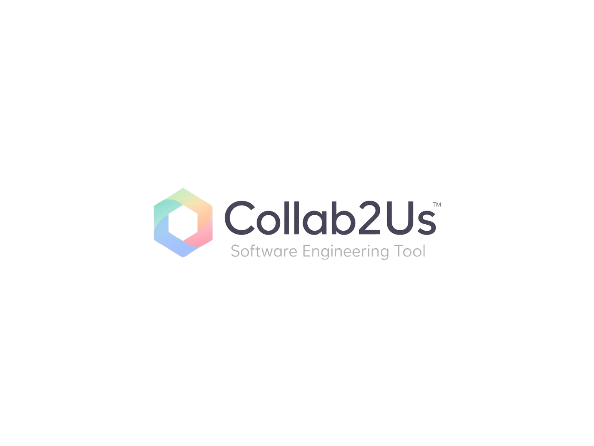
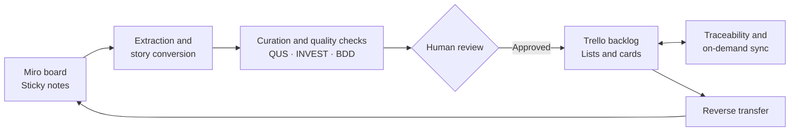

<div align="center">
  
  <h1>Collab2Us</h1>
  <p><strong>From visual ideation to validated, delivery-ready user stories.</strong></p>
  <p>Connect Miro discovery boards with Trello delivery backlogs, keeping people in control of requirement quality.</p>
</div>

<p align="center">
  <a href="#overview">Overview</a> ·
  <a href="#key-features">Features</a> ·
  <a href="#how-it-works">How it works</a> ·
  <a href="#getting-started">Getting started</a> ·
  <a href="#configuration">Configuration</a> ·
  <a href="#architecture">Architecture</a> ·
  <a href="#license">License</a>
</p>

---

## Overview

**Collab2Us** is an academic web application that bridges visual product discovery in [Miro](https://miro.com/) and agile backlog delivery in [Trello](https://trello.com/). It turns board notes into structured user stories, provides quality checks and AI-assisted refinement, and lets a person review stories before they are exported to a Trello backlog.

The application follows a human-in-the-loop workflow: automation speeds up the work, while the user remains responsible for validating what is delivered to the team.

## Key features

- **Miro and Trello integration**: connect accounts, browse boards, and work with discovery and delivery artifacts in one place.
- **User-story conversion**: extract Miro sticky notes and organize them into candidate stories using automatic, graph-based, spatial, or standalone modes.
- **Human review before export**: edit, enable, disable, and inspect proposed stories before creating Trello cards.
- **Quality analysis**: assess story structure with the QUS quality score, review INVEST criteria, and generate BDD-style acceptance criteria.
- **AI-assisted writing** (optional): refine stories, split large requirements, and generate ideation notes with OpenAI, Google Gemini, or Anthropic Claude.
- **Flexible templates**: Connextra, Jobs To Be Done (JTBD), a custom template, or raw text.
- **Traceability and synchronization checks**: keep mappings between Miro items and Trello cards, detect differences, and apply updates on demand.
- **Reverse transfer**: create Miro sticky notes from Trello cards.
- **Metrics and workflow preferences**: review synchronization metrics and customize quality thresholds, templates, colors, and AI settings.
- **Account management**: register or sign in, manage profile settings, and connect supported services.

## How it works



1. **Connect your boards.** Sign in and authorize the Miro and Trello integrations.
2. **Extract and prepare.** Select a Miro board and convert its sticky notes into draft user stories.
3. **Review the content.** Refine titles, story statements, and acceptance criteria; inspect quality indicators and choose which stories to export.
4. **Export to Trello.** Choose the destination board and list. Approved stories become Trello cards, and the mapping is saved for traceability.
5. **Check synchronization.** Review detected differences and apply updates when appropriate. Trello cards can also be transferred back to Miro.

AI assistance is optional. Without a configured AI provider, the application falls back to rule-based behavior, and AI-backed features are limited.

## Getting started

### Prerequisites

- Node.js and npm.
- PostgreSQL. A database is **required** for the integrations: OAuth tokens, story mappings, workflow settings, metrics, and synchronization records are stored there. Without it, only a limited in-memory user fallback exists and the Miro/Trello integrations do not work.
- OAuth application credentials for the services you want to connect (Google, Miro, Trello).
- An API key from a supported AI provider, only if you want live AI-assisted features.

### 1. Install dependencies

```bash
npm ci
```

### 2. Create your local environment file

```bash
cp .env.example .env
```

On Windows PowerShell, use `Copy-Item .env.example .env`. Fill in the values for your setup and never commit `.env`.

### 3. Configure PostgreSQL

Choose **one** connection method:

- set `DATABASE_URL`; or
- set `PGHOST`, `PGPORT`, `PGUSER`, `PGPASSWORD`, and `PGDATABASE`.

The template uses `localhost:5432` and a database named `Collab2Us`. Create the database before starting the application. On startup the server applies `server/sql/schema.sql` and the compatibility migrations.

### 4. Configure OAuth callbacks

Register these URLs in each provider application. They must match the redirect URIs in `.env` and the public URL of your server.

| Provider | Local callback URL |
| --- | --- |
| Google | `http://localhost:8080/auth/redirect/google` |
| Miro | `http://localhost:8080/auth/redirect/miro` |
| Trello | `http://localhost:8080/auth/redirect/trello` |

Adjust them when running behind a different host, port, proxy, or HTTPS endpoint.

### 5. Start the application

```bash
npm run dev
```

For a production build:

```bash
npm run build
npm start
```

The scripts are defined in `package.json`. Run `npm run` to list the ones available in your checkout.

## Configuration

### Environment variables

| Group | Variables | Purpose |
| --- | --- | --- |
| Session security | `JWT_SECRET` | Secret used to sign session JWTs. **Required in production**; use a strong, unique value. |
| Encryption | `ENCRYPTION_KEY` | Key used to encrypt AI provider API keys before they are stored. **Required in production**; use a strong, unique value (32+ characters). |
| Server | `SERVER_URL`, `PORT`, `NODE_ENV` | Public server address, listening port, and runtime mode. |
| CORS | `CLIENT_URL` | Allowed browser origin in production (falls back to `SERVER_URL`). |
| PostgreSQL | `DATABASE_URL` or `PGHOST`, `PGPORT`, `PGUSER`, `PGPASSWORD`, `PGDATABASE`, `PGSSLMODE` | Database connection. `PGSSLMODE=require` enables SSL. |
| Google OAuth | `GOOGLE_CLIENT_ID`, `GOOGLE_CLIENT_SECRET`, `GOOGLE_REDIRECT_URI` | Google sign-in. |
| Miro OAuth | `MIRO_CLIENT_ID`, `MIRO_CLIENT_SECRET`, `MIRO_REDIRECT_URI` | Miro authorization and token refresh. |
| Trello | `TRELLO_KEY`, `TRELLO_REDIRECT_URI` | Trello authorization and API access. |
| AI (optional fallback) | `OPENAI_API_KEY`, `GEMINI_API_KEY`, `CLAUDE_API_KEY` | Server-wide keys used when a user has not saved a personal key. |

The template also lists `DB_AUTO_MIGRATE`, `ENABLE_SAVE_TOKEN_*`, `ENABLE_EXPOSE_TOKENS`, and `TRELLO_SECRET`. They are reserved and currently have no effect on the application.

AI provider, model, API key, and optional system prompt are configured per user on the **Workflow** page. Use only keys you are authorized to use.

### Database schema

`server/sql/schema.sql` defines users, OAuth tokens, Miro-to-Trello story mappings, synchronization jobs, workflow settings, and academic evaluations.

## Application areas

| Area | What it is for |
| --- | --- |
| **Home** | Overview of the workflow and a demo simulation. |
| **Boards** | Browse and manage Miro and Trello boards; apply structured Miro canvases or generate ideation notes. |
| **User Stories** | Extract, curate, validate, refine, split, and export stories. |
| **Metrics** | Review synchronization and operation metrics. |
| **Workflow** | Configure AI provider, templates, quality thresholds, and Miro color semantics. |
| **Settings** | Manage account details and integration tokens. |
| **References** | Methodological references used by the application. |

## Architecture

Collab2Us follows a three-tier architecture:

| Layer | Technologies | Responsibilities |
| --- | --- | --- |
| Presentation | React, TypeScript, Vite, Tailwind CSS | User interface, pages, and client-side state. |
| Business logic | Node.js, Express, TypeScript | Authentication, API routes, integration orchestration, conversion, AI calls, and synchronization. |
| Persistence | PostgreSQL | Users, OAuth tokens, mappings, sync history, workflow settings, and evaluation data. |

### Repository layout

```text
.
├── client/                 # React application, pages, components, and hooks
├── public/                 # Public assets
├── server/
│   ├── middleware/         # Authentication middleware
│   ├── models/             # User and OAuth-token access
│   ├── routes/             # Express route handlers
│   ├── services/           # Miro, Trello, AI, and conversion logic
│   ├── sql/schema.sql      # PostgreSQL schema
│   ├── db.ts               # Database connection and migrations
│   └── index.ts            # Express application and API registration
├── shared/                 # Shared types and API contracts
├── .env.example            # Environment-variable template
├── CITATION.cff            # Citation metadata
├── LICENSE                 # PolyForm Strict License 1.0.0
└── README.md
```

## API overview

Application endpoints are exposed under `/api`. Representative routes:

| Endpoint | Purpose |
| --- | --- |
| `GET /api/miro/boards` | List Miro boards. |
| `GET /api/trello/boards` | List Trello boards. |
| `GET /api/convert/preview` | Preview stories extracted from a Miro board. |
| `POST /api/convert/commit` | Export curated stories to a Trello list. |
| `GET /api/convert/sync-check` | Check for synchronization differences. |
| `POST /api/convert/sync-pull` | Apply a selected synchronization update. |
| `POST /api/convert/trello-to-miro` | Create Miro sticky notes from Trello cards. |
| `/api/ai/*` | List supported models and run AI-assisted story operations. |

Most endpoints require an authenticated session, carried by an HTTP-only cookie.

## Tests

```bash
npx vitest run
```

## Security and privacy

- Set strong, unique values for `JWT_SECRET` and `ENCRYPTION_KEY` before deploying. Do not rely on any default.
- Never commit `.env`, OAuth secrets, database credentials, access tokens, or AI API keys.
- Configure each provider's callback URL to match the deployed server URL exactly, and use HTTPS in production.
- Restrict database access to trusted services and use PostgreSQL SSL where your hosting requires it.
- Review integration permissions before authorizing Miro, Trello, or Google access.
- The application stores personal data (name, e-mail, integration tokens). Anyone who hosts it is responsible for compliance with applicable data-protection law, such as Brazil's LGPD (Lei 13.709/2018).
- Research that involves human participants (for example, usability evaluations with TAM or SUS questionnaires) may require ethics review under the rules of the responsible institution.

## Authors and acknowledgments

- **Author:** Pedro Lucas Dornelles dos Santos
- **Advisor:** Prof. Dr. Rafael Baldiati Parizi

To cite this software, use the metadata in [`CITATION.cff`](CITATION.cff).
